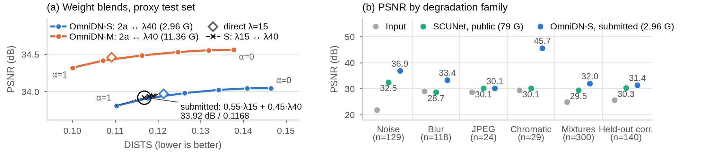

# OmniDN-S: a 3-GFLOP network for blind image restoration

m25csa016 — IIT Jodhpur · Technical report, Mini Competition "A Small Generative Model for Image Denoising" · 20 October 2026

**Summary.** OmniDN-S is a 6.66 M-parameter NAFNet-style U-Net with a global-attention bottleneck: **2.963 GFLOPs** per 256×256 image (fvcore, 1 MAC = 1 flop; 3.01 GMac with ptflops). It is trained on 75,602 natural, low-light and medical samples corrupted on the fly by 21 operators, fine-tuned on the competition metrics, and its weights blend two DISTS-trained fine-tunes. On our own proxy test set (600 synthetic pairs from 300 images never trained on) it scores **33.92 dB / 0.9032 SSIM / 0.1168 DISTS** (31.38 / 0.8568 / 0.1664 on 140 pairs with corruptions unseen in training), vs 30.03 / 0.8070 / 0.2303 for public SCUNet (27× the FLOPs).

## 1. Architecture

OmniDN-S is a U-Net with four stride-2 conv downsamplings (256 → 16 px) of NAFNet blocks [1] (LayerNorm → 1×1 → 3×3 depthwise → SimpleGate → simplified channel attention → 1×1, plus a gated FFN; zero-init residual scales). The encoder has 16/32/64/128 channels with 1/1/2/4 blocks; the decoder has one block per level (1×1 conv + PixelShuffle, additive skips). **(i) Deep-skewed:** channels double as resolution halves, so a block costs ≈6c²HW ≈ 0.10 GFLOPs at every level, but at 16×16 a 3×3 kernel spans 16× more of the image; 12 of the 24 blocks thus sit in the 16×16×256 bottleneck (45% of the FLOPs) for a large receptive field on long blurs. **(ii) Global attention:** two of those 12 are 4-head self-attention over all 256 tokens (0.15 GFLOPs each with FFN), so every output pixel sees the whole image. **(iii) CoordConv [6]:** two coordinate input channels, as chromatic aberration and lens blur grow off-centre. A global residual and an in-graph uint8 output quantiser (0 FLOPs) complete it. These choices rest on cost and receptive-field arguments and were not ablated. OmniDN-M: width 32, 11.36 GFLOPs, 26.4 M params.

## 2. Training data

**Training set.** 75,602 samples from 21 public sources (60,948 distinct images + 14,654 native 512² crops of those with short side ≥ 1024), stored as PNG with long side ≤ 512 (short side ≥ 256). **Natural (31,884):** LSDIR (20k subset), Flickr2K, FFHQ (1.5k + crops), DIV2K, normal-light LOL-v2/SICE. **Medical (40,953):** chest X-ray (NIH-14, paediatric, Shenzhen, Montgomery), dental X-ray, MRI (IXI T1/T2, brain), CT (LoDoPaB), ultrasound (BUSI, HC18), BreaKHis histology, FIVES fundus, HAM10000 dermoscopy. **Low-light (2,765):** real dark LOL-v2/SICE frames (mean luminance ≤ 0.30, with some sensor noise); also, 10% of natural images are darkened (a·x^γ) before degradation, target included, so the model learns not to brighten. Domains are drawn 55/33/12%, sources weighted by √(size). As test images are likely whole images resized to 256, patches are random-downscale crops, square or aspect-ignoring resizes, or native crops (45/20/15/20%); plus flips/rot90, 4% gray natural targets.

**Held-out data.** 1,108 images are never trained on: Kodak24, CBSD68, McMaster, Urban100, DIV2K-val (100), LSDIR-val (250), LOL-v2 test (320) and 228 images from all 14 medical sources. From them we built two sets with plain skimage / cv2 / PIL / np.roll calls, not our engine. **Proxy test set** (600 pairs from 300 images: 140 natural, 50 low-light, 110 medical): per image, one of 20 single-operator specs as a test author would likely write them (e.g. skimage `random_noise` defaults, `cv2.GaussianBlur((5,5),0)`, JPEG q10/q30) and one of 10 two-/three-operator mixtures. **Held-out-corruption set** (140 pairs): four types never produced in training (glass blur, zoom blur, uniform noise, JPEG2000) and three rare variants (salt-then-blur, skimage "localvar", noise-then-motion). Both are our own sets, not the hidden test, and guided the stage-2 mix, loss weights and blend: absolute numbers are optimistic, and small gaps between candidates should not be over-read.

## 3. Degradation pipeline

**Composition.** Each pair draws 0–4 operators (p = 0.04/0.42/0.34/0.16/0.04) without replacement; the 4% clean→clean pairs teach the model to leave clean images alone. At most one compression operator is kept. 80% of chains follow physical order (optics → resampling → sensor noise → impulse/artefacts → compression last); 20% are shuffled as in BSRGAN [5], compression included. Each output is clipped to [0, 1]; with p = 0.08 a second chain fills a random region (degradation CutMix); the result is rounded (not truncated) to uint8, like the test PNGs.

**Excluded on purpose:** brightness/contrast/gamma shifts, vignetting and haze, which a blind model cannot tell from dark or flat content ("fixing" them would harm clean low-light/medical images), and the four unseen types of §2 (kept for testing).

**Table 1.** The 21 operators with sampling weight (%) in stage 1 → 2 (stage 2 favours the task's named types: Gaussian noise, JPEG, blur). Where a common library call exists, its default parameter (e.g. σ = 0.1, s&p amount 0.05) is used in 30–40% of draws.

| Family: operators, weight % | Severities and library behaviour |
|---|---|
| *Additive noise:* Gaussian 17.4→20.5, correlated 2.6→1.6, chroma 1.7→0.8 | σ = 0.1 (skimage default) in 30%, else 1–75/255; per-channel / gray / correlated 65/20/15%; 10% Laplacian · correlated σ 3–40/255 · chroma blotches |
| *Signal-dep.:* Poisson 7.0→6.6, Poisson-Gauss 4.3→4.1, camera 3.5→3.3, banding 1.7→0.8, Rician 1.7→1.2 | 40% exact skimage Poisson rule, else peak 2–500 · std √(a·x + b) · shot + read noise on an RGGB mosaic, demosaiced · row/column banding · Rician σ 0.01–0.12 |
| *Speckle, impulse:* speckle 6.1→5.7, impulse 7.0→6.6 | x + x·n, var 0.01 (default) or 0.003–0.3, 15% Gamma · s&p 0.05 (default) or 0.003–0.25, per element (skimage) or per pixel |
| *Blur:* Gaussian 8.7→9.0, motion 6.1→7.4, defocus 5.2→5.7 | 35% `cv2.GaussianBlur((k,k),0)`, k 3–15, else σ 0.3–4, aniso · H/V line k 5–21, any-angle line 3–31 px, or shake · disk r 1–8, box, median |
| *Optics, resampling:* chromatic aberration 5.2→4.9, down-up 3.5→3.3, pixelate 1.3→0.7 | R/B radial scale 0.2–2%, ≤ 4 px shift (`np.roll` or replicate) or radial distortion; 30% axial blur · resize ×0.25–0.9 · pixelate ×0.2–0.6 |
| *Compression:* JPEG 10.4→14.7, WebP 1.7→0.8 | q 5–95, 4:2:0 (85%), 15% double JPEG; WebP q 5–90 |
| *Artefacts:* ringing 1.7→0.8, posterize 1.3→0.7, dust 1.7→0.8 | unsharp halos or jinc ringing [7]; 3–6 bits, 30% dithered; ≤ 11 dust spots/scratches + dead pixels |

## 4. Training objective and schedule

**Metric-aligned losses.** PSNR-loss = (1/B)·Σᵢ 10·log10 MSEᵢ, exactly minus the per-image mean PSNR. The SSIM term re-implements skimage `structural_similarity` defaults (7×7 uniform window, sample covariance, 3-px border crop) to float precision (|Δ| ≈ 1e-5); at weight 30, 0.01 SSIM is worth 0.3 dB. Final objective: L = PSNR-loss + 30·(1 − SSIM) + λ·DISTS.

**Perceptual stage (our reading of "generative").** OmniDN is a deterministic single-pass network; we trained no GAN or diffusion model. Stage 2b adds DISTS [3] (official VGG weights, frozen, fp32, full image), which compares deep-feature means and correlations (texture statistics, not pixels) and so pulls outputs away from the over-smoothed minimum-MSE estimate (proxy DISTS 0.147 → 0.110 at λ = 40) while the fidelity terms stay. Two such fine-tunes (λ = 40, 15) start from 2a; blending their weights (network interpolation [4]) sets the perception–distortion operating point at no inference cost. No GAN was tried: two of three quality metrics measure fidelity, adversarial fine-tunes typically cost 1–2 dB in SR, and iterative sampling exceeds 3 GFLOPs.

**Table 2.** Training of OmniDN-S, one A30 GPU per stage. All stages: batch 32 × 256², AdamW (β = (0.9, 0.9) in stage 1, (0.9, 0.99) after; no weight decay), grad clip 1 / 5, EMA 0.999 (final EMA exported; no best-checkpoint selection), bf16 autocast, fp32 losses. M: 0.6× the learning rates.

| Stage | Loss | Schedule | Iterations |
|---|---|---|---|
| 1 Fidelity (from scratch) | Charbonnier (ε = 1e-3) + 0.05·FFT-L1 | lr 1e-3, 1% warm-up, cosine to 1e-6 over 20 h wall-clock | 669,511 |
| 2a Metric-aligned (from 1) | PSNR-loss + 30·(1 − SSIM) | lr 1e-4, 2% warm-up, cosine to 1e-6 over 1.5 h; stage-2 mix | 45,107 |
| 2b Perceptual (2 runs from 2a) | 2a loss + λ·DISTS, λ = 40 and 15 | as 2a | 15,970 / 16,192 |
| 3 Weight blend | θ = 0.55·θ(λ15) + 0.45·θ(λ40) | offline; same network, no extra FLOPs | – |

## 5. Results

**Table 3.** Organiser-style evaluation (skimage PSNR/SSIM on uint8, official DISTS, fp32); the submitted row is from the submission folder.

| Model | GFLOPs | Proxy test (600): PSNR / SSIM / DISTS | Held-out corruptions (140) |
|---|---|---|---|
| Identity (input returned) | 0 | 25.43 / 0.6184 / 0.2831 | 25.59 / 0.5920 / 0.2891 |
| SCUNet [2], public pretrained | 79.0 | 30.03 / 0.8070 / 0.2303 | 30.25 / 0.8062 / 0.2297 |
| S, stage 1 | 2.96 | 33.96 / 0.9038 / 0.1495 | 31.54 / 0.8598 / 0.1916 |
| S, stage 2a (fidelity) | 2.96 | 34.04 / 0.9059 / 0.1465 | 31.51 / 0.8595 / 0.1910 |
| S, 0.2·θ(2a) + 0.8·θ(λ40) (earlier choice) | 2.96 | 33.91 / 0.9032 / 0.1177 | 31.38 / 0.8569 / 0.1679 |
| **S, 0.55·θ(λ15) + 0.45·θ(λ40) (submitted)** | **2.96** | **33.92 / 0.9032 / 0.1168** | **31.38 / 0.8568 / 0.1664** |
| M, 0.2·θ(2a) + 0.8·θ(λ40) (not submitted) | 11.36 | 34.42 / 0.9095 / 0.1072 | 31.60 / 0.8595 / 0.1618 |

Per domain it scores 30.25 / 38.34 / 36.59 dB (natural / low-light / medical). SCUNet [2] (public real-noise weights) was trained on noise, JPEG and resizing, not blur, impulse noise or chromatic aberration (CA). Per spec, OmniDN-S is within 0.4 dB of it on Gaussian noise and JPEG (≤ 0.4 dB behind at σ = 50 and JPEG q30/q40, also mixed) and ahead by 3.1–6.1 dB on single blurs and 11–16 dB on impulse noise and CA (Fig. 1b: family means). On held-out corruptions, uniform noise (+12.6 dB vs input) and the rare variants (+6.9 to +11.8 dB) are restored, but unseen blur and compression are not (glass blur +0.35 dB, zoom blur −0.44, JPEG2000 −0.26; SCUNet likewise). At extreme severities (10 specs × 60 images, e.g. σ = 75, JPEG q5) all gain 2.1–22.4 dB.

**Table 4.** Ablations on the proxy test set (fp32; λ = DISTS weight). Rows 1–5: 43-min S fine-tunes from one stage-1 snapshot (33.25 dB); the reference fine-tune without DISTS scores 33.43 / .898 / .157. Rows 6–7: 1.5 h runs from 2a vs the 2a ↔ λ40 curve.

| Ablation | PSNR / SSIM / DISTS | Finding → decision |
|---|---|---|
| DISTS weight λ = 40 | 33.16 / .892 / .124 | −0.033 DISTS for −0.27 dB vs the reference |
| DISTS weight λ = 120 | 32.87 / .886 / .117 | only −0.007 more DISTS for −0.29 dB more → λ = 40 |
| Blend λ = 0 ↔ λ = 40, α = 0.5 | 33.36 / .897 / .143 | 24% of the PSNR drop for 43% of the DISTS gain; λ120 end worse → blend |
| + distillation from M (w = 0.5) | 33.38 / .897 / .158 | 2.4× slower, −0.05 dB at equal time → dropped |
| SSIM weight 100 instead of 30 | 33.37 / .899 / .157 | +0.0009 SSIM for −0.06 dB → keep 30 |
| Direct λ = 15, S | 33.97 / .904 / .121 | −0.004 DISTS vs the curve at equal PSNR (≈α 0.63), SSIM −0.0004 |
| Direct λ = 15, M | 34.46 / .910 / .109 | −0.004 DISTS (≈α 0.67), SSIM −0.0002 → blend λ15 with λ40 |

**Choosing the operating point and model size.** As the score sums four ranks, we simulated fields of 40 other entries: log-uniform-mixture FLOPs over 0.2–400 G, PSNR ~ N(ours − Δ, 1.5 dB) for Δ = 0–3 dB, and SSIM/DISTS following PSNR along the slope between our two fidelity-only models (noise ±0.01/±0.02), i.e. assuming few entries optimise DISTS. Candidates (α: λ40 weight in the 2a ↔ λ40 blend) were scored as 0.75·proxy + 0.25·held-out. Mean summed rank (lower is better, best 4): S α0.8 37.73, S α0.6 38.14, M α0.8 38.19, fidelity-only M/S 42.05/42.46; α 0.6–0.8 won every scenario. M leads S by 0.50 dB (proxy) but 0.22 dB (held-out) at 3.8× the FLOPs, and won only for fields within ≈1 dB of us; N = 20/80 fields and Gaussian-window SSIM changed nothing. The λ = 15 runs came later: 0.55·λ15 + 0.45·λ40 matches S α0.8 (+0.010 dB, SSIM within 1e-4) at 0.0009 lower DISTS (held-out: +0.002 dB, −0.0015) and equal FLOPs, so we submitted it (marginal, not significant).

## 6. Efficiency and fair play

**FLOPs.** fvcore 2.963 G, ptflops 3.014 / 3.003 GMac (pytorch / aten backends). All heavy compute is `nn.Conv2d` / `torch.matmul`, seen by every counter: no FFT layer (FFT is only in the stage-1 loss), fused attention, functional conv or custom autograd op; uncounted elementwise work ≈4%. Fixed graph: no input-dependent routing, early exit, test-time augmentation or ensembling. **Output.** `forward()` clamps and snaps to k/255, so rounding, truncation and PIL agree (an unclamped `(y*255).astype(uint8)` had cost ≈4.5 dB via wrap-around). LayerNorm statistics are fp32, so `model.half()` stays within ±1 level of fp32 (it had collapsed to 13.1 dB). **Evaluation.** `scripts/verify_submission.py` on the submission folder gives 33.9222 / 0.9032 / 0.1168; an independent from-scratch evaluator reproduced the earlier α0.8 package to four decimals.

*References. [1] Chen et al., NAFNet, ECCV 2022. [2] Zhang et al., SCUNet, MIR 2023. [3] Ding et al., DISTS, TPAMI 2022. [4] Wang et al., ESRGAN, ECCV-W 2018. [5] Zhang et al., BSRGAN, ICCV 2021. [6] Liu et al., CoordConv, NeurIPS 2018. [7] Wang et al., Real-ESRGAN, ICCV-W 2021.*
