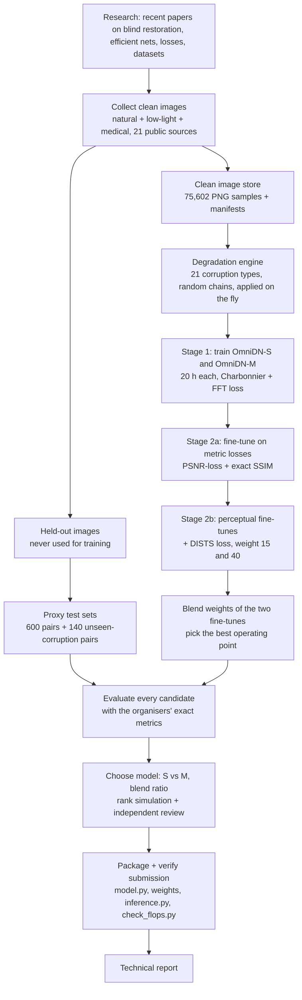

# Project Flow — OmniDN-S: a small model for blind image restoration

## 1. The task in one paragraph

Build one model that takes a corrupted 256×256 RGB image and returns a clean 256×256 uint8 image. The images come from
natural photos, low-light photos and medical scans (X-ray, MRI, …), and the corruption is unknown (noise, blur, JPEG,
chromatic aberration, mixtures, or something unseen). Submissions are ranked separately on four metrics with equal
weight:
- FLOPs (lower is better)
- PSNR (higher is better)
- SSIM (higher is better)
- DISTS (lower is better)

So the model must be **small** and still **good on all three quality metrics**.

## 2. Overall workflow



Text version of the same flow:

```
research → clean data (75.6k) → degradation engine → stage 1 training (S and M, 20 h)
        → stage 2a metric fine-tune → stage 2b DISTS fine-tunes → weight blending
        → evaluation on held-out proxy sets → model choice → packaged submission → report
```

## 3. Each step in short

| Step | What happens | Where |
|---|---|---|
| 1. Research | Read recent work on blind/all-in-one restoration, efficient architectures, FLOP counting, losses matching PSNR/SSIM/DISTS, datasets | `docs/research/` |
| 2. Data | Download public datasets, resize (long side ≤ 512), store as PNG, write one manifest per source; hold out validation images | `scripts/data/`, `src/dncomp/data/prep_utils.py` |
| 3. Degradations | For each training image, apply 0–4 random corruptions (noise, blur, JPEG, chromatic aberration, …), then round to uint8 | `src/dncomp/data/degradations.py` |
| 4. Model | OmniDN: small NAFNet-style U-Net with most blocks at low resolution and global attention in the bottleneck | `src/dncomp/models/omnidn.py` |
| 5. Training | Stage 1 (fidelity), stage 2a (metric losses), stage 2b (DISTS loss); SLURM jobs on A30 GPUs | `src/dncomp/train.py`, `configs/`, `scripts/slurm/` |
| 6. Evaluation | Same metric calls as the organisers (skimage PSNR/SSIM, official DISTS, fvcore/ptflops) on our proxy test sets | `src/dncomp/evaluate.py`, `scripts/verify_submission.py` |
| 7. Selection | Compare S vs M and the blend ratios; simulate competition ranks | `scripts/interpolate_and_eval.py`, `scripts/rank_simulation.py` |
| 8. Packaging | Export the chosen weights into a standalone folder and verify it end to end | `scripts/package_submission.py`, `submission/` |

## 4. Final result

Final model: **OmniDN-S**, 2.963 GFLOPs (fvcore), 6.66 M parameters.

| Model | GFLOPs | PSNR / SSIM / DISTS (proxy test, 600 pairs) | Unseen corruptions (140 pairs) |
|---|---|---|---|
| Input (no restoration) | 0 | 25.43 / 0.618 / 0.283 | 25.59 / 0.592 / 0.289 |
| SCUNet (public pretrained) | 79 | 30.03 / 0.807 / 0.230 | 30.25 / 0.806 / 0.230 |
| **OmniDN-S (submitted)** | **2.96** | **33.92 / 0.903 / 0.117** | **31.38 / 0.857 / 0.166** |

These numbers are on our own held-out sets, not the hidden test set.

## 5. How to run the submission

```bash
cd omnidn_s_submission
pip install -r requirements.txt
python inference.py --input noisy_folder/ --output restored_folder/
python check_flops.py
```

## 6. Where to read more

- `docs/02_experiment_log.md`: every experiment and decision, in time order.
- `technical_report.pdf`: the 2-page technical report.
